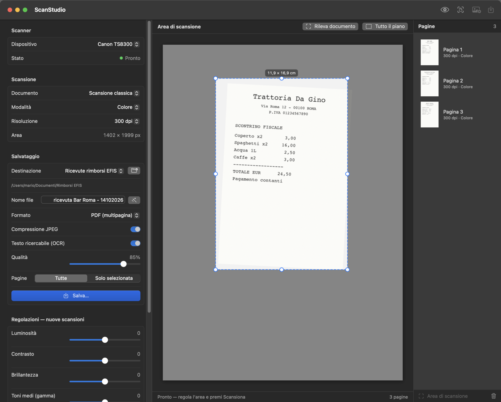
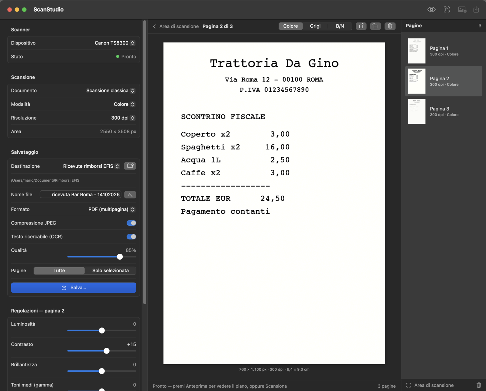
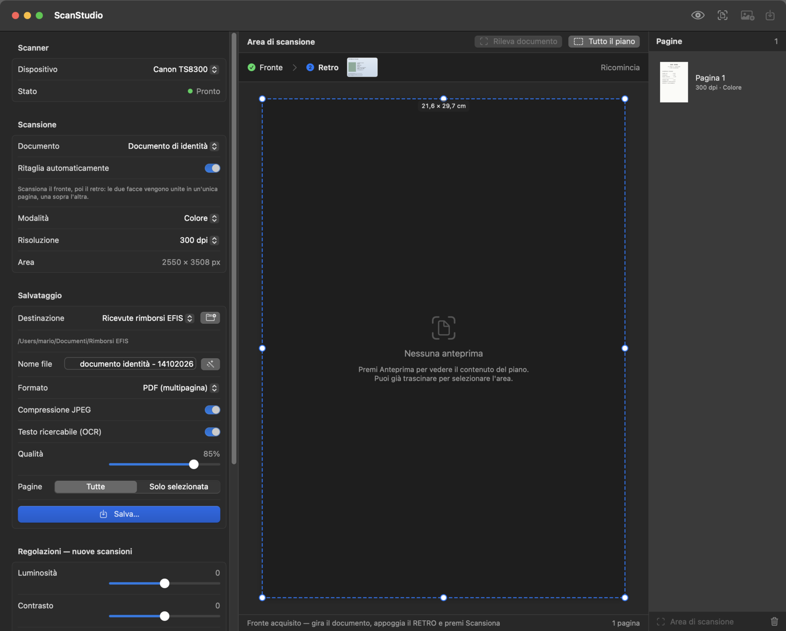
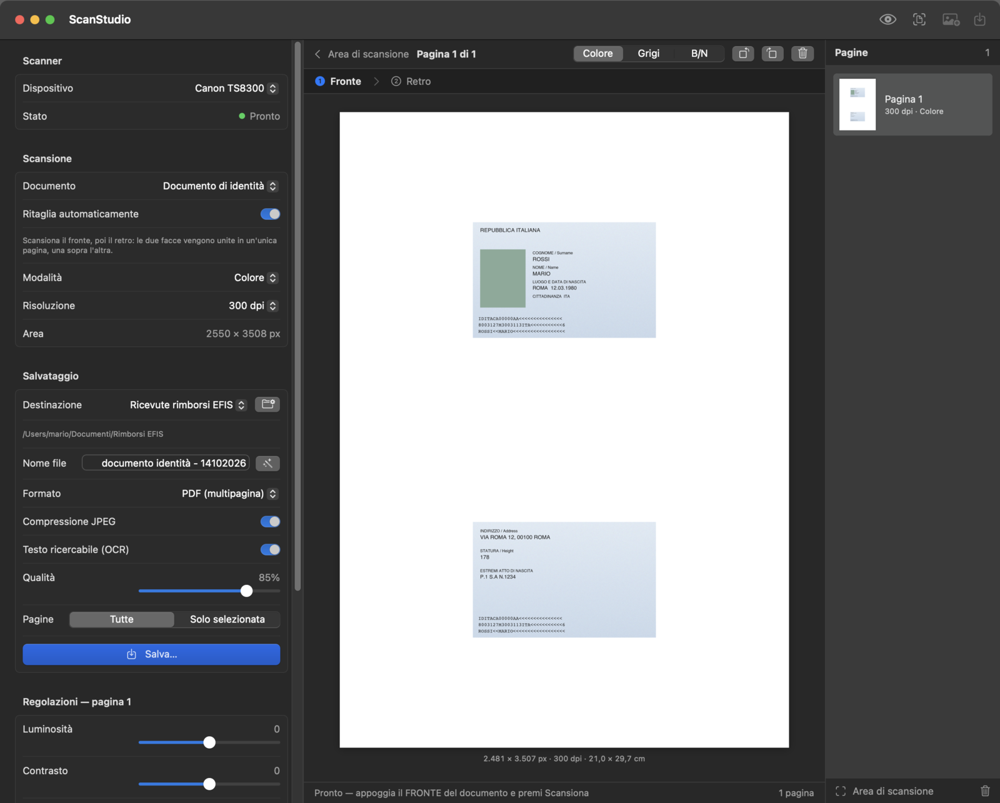

# ScanStudio

App nativa per macOS (Swift + SwiftUI) per acquisire documenti da scanner, anche multipagina,
con anteprima, selezione dell'area, regolazioni dell'immagine e salvataggio in PDF, PNG, JPEG o TIFF.
L'interfaccia è in italiano.

Comunica con lo scanner tramite **ImageCaptureCore**, lo stesso framework usato da
*Acquisizione Immagini* e *Anteprima*: funziona con qualunque scanner che macOS riconosce
(USB, di rete/Bonjour, AirScan/eSCL, condiviso).



## Indice

- [Requisiti](#requisiti)
- [Compilazione](#compilazione)
- [Come si usa](#come-si-usa)
- [Funzioni](#funzioni)
- [Scorciatoie da tastiera](#scorciatoie-da-tastiera)
- [Risoluzione dei problemi](#risoluzione-dei-problemi)
- [Note tecniche](#note-tecniche)
- [Struttura del progetto](#struttura-del-progetto)

## Requisiti

- macOS 14 Sonoma o successivo
- Xcode 15 o successivo, oppure i soli Command Line Tools (`xcode-select --install`)
- Uno scanner supportato da macOS (nessun driver aggiuntivo se funziona in *Acquisizione Immagini*)

## Compilazione

**Con Xcode:** apri `ScanStudio.xcodeproj`, scegli lo schema *ScanStudio* → *My Mac* e premi ⌘R.

**Da terminale** (crea `build/ScanStudio.app` con icona e firma ad-hoc):

```bash
./build-app.sh
open build/ScanStudio.app
```

**Solo per sviluppo:** `swift build` e `swift run ScanStudio` usano `Package.swift`. In questo caso
l'eseguibile parte senza bundle `.app`.

> Primo avvio: essendo firmata ad-hoc, se macOS blocca l'app usa clic destro → *Apri*.
>
> Se aggiungi o rimuovi file `.swift`, rigenera il progetto Xcode con `python3 generate-xcodeproj.py`.
> Lo script sovrascrive le modifiche fatte a mano al progetto.

## Come si usa

1. **Scegli lo scanner.** All'avvio l'app lo cerca da sola. Quando lo stato diventa *Pronto*
   (pallino verde) puoi scansionare. Se resta *Non connesso* usa il pulsante *Riconnetti*.
2. **Anteprima (facoltativa).** Con il piano di scansione premi *Anteprima* (⇧⌘P), poi trascina per
   selezionare l'area oppure premi *Rileva documento*.
3. **Scansiona** (⌘R). Ogni scansione aggiunge una pagina all'elenco a destra. Con l'alimentatore
   ogni foglio diventa una pagina.
4. **Rivedi e correggi.** Clicca una pagina per vederla: puoi ruotarla, cambiare modalità colore
   e regolare luminosità, contrasto e le altre impostazioni con anteprima dal vivo.
5. **Salva** (⌘S). Scegli la destinazione e il nome del file (proposto in automatico) e il formato.



## Funzioni

### Scanner e sorgente

- Rilevamento automatico degli scanner locali e di rete, scelta del dispositivo
- Riconnessione automatica se lo scanner viene acceso dopo l'app o va in standby
- Sorgenti: piano, alimentatore automatico (ADF), diapositive/negativi se presenti
- ADF: formato pagina (A4, A5, Letter, Legal, massimo) e fronte/retro se supportato

### Acquisizione

- Anteprima rapida del piano (⇧⌘P)
- Selezione dell'area: trascina per creare, sposta trascinando dentro, ridimensiona da bordi e angoli;
  etichetta con le dimensioni in cm
- *Rileva documento*: individua automaticamente il foglio nell'anteprima (Vision)
- Modalità: colore, scala di grigi, bianco e nero
- Risoluzione: valori supportati dal driver, con stima dei pixel risultanti

### Tipo di documento

Il menu *Documento* nella sezione *Scansione* offre due modalità.

- **Scansione classica:** ogni scansione è una pagina.
- **Documento di identità:** una procedura guidata in due passi. Scansioni il **fronte**, poi giri
  la carta e scansioni il **retro**. Le due facce vengono unite in **un'unica pagina A4**, una sopra
  l'altra e senza sovrapposizioni, ciascuna a dimensioni reali. La barra *Fronte → Retro* sopra l'area
  centrale mostra a che punto sei; *Ricomincia* scarta il fronte già acquisito.
  Con l'alimentatore in fronte/retro le due pagine consecutive diventano fronte e retro in automatico.



Con l'opzione **Ritaglia automaticamente** (attiva di default) ogni faccia viene:

- ritagliata sul bordo della carta;
- **raddrizzata** se è appoggiata storta sul piano;
- ruotata in orizzontale e **capovolta se è stata scansionata al contrario**. Il verso si ricava dalla
  direzione di lettura del testo, con l'OCR di Vision.



### Destinazioni e nome del file

- **Destinazioni predefinite:** cartelle salvate con un nome, ad esempio *Ricevute rimborsi EFIS* o
  *Documenti personali*. Le scegli al volo dal menu *Destinazione* nella sezione *Salvataggio*; con una
  destinazione scelta il file viene salvato direttamente, senza finestra di salvataggio. Con
  *Chiedi ogni volta* compare il pannello di salvataggio classico.
- Il pulsante accanto al menu apre la finestra di gestione: aggiungi, rinomina, cambia cartella,
  elimina. Destinazioni e scelta restano salvate tra un avvio e l'altro.
- **Nome file proposto**, modificabile, in base al documento riconosciuto. Il modello predefinito è
  `{tipo} {attività} - {data}`, ad esempio `ricevuta Bar Roma - 14102026`. Ogni destinazione può avere il
  proprio modello.
- Se un file con lo stesso nome esiste già, viene aggiunto un numero (`… 2`, `… 3`).


### Riconoscimento del documento

Il nome del file si basa sul testo della prima pagina (o della pagina selezionata, se salvi solo quella),
letto con l'OCR di **Vision** e analizzato con **NaturalLanguage**. Tutto avviene sul Mac, senza servizi esterni.

- **Tipo** (`{tipo}`): ricevuta/scontrino, fattura, carta d'identità, passaporto, patente, tessera sanitaria;
  altrimenti *documento*.
- **Attività** (`{attività}`): l'esercente. È ricavato dall'intestazione, preferendo le righe più grandi e
  quelle con una forma societaria (S.r.l., S.p.A., …), e scartando indirizzi, partita IVA, telefoni. I nomi
  in maiuscolo diventano leggibili e le sigle societarie vengono tolte.
- **Data** (`{data}`): la data di oggi nel formato `ggMMaaaa`.

Il riconoscimento è un suggerimento: puoi sempre correggere il nome. Appena lo modifichi a mano non viene più
sovrascritto; il pulsante a bacchetta lo ripropone.

### Regolazioni

In anteprima dal vivo, per la singola pagina o per le nuove scansioni:

- Luminosità, contrasto, brillantezza (esposizione), toni medi (gamma), saturazione
- Nitidezza, riduzione rumore, soglia bianco/nero
- Miglioramento automatico, inversione (negativi)
- Doppio clic sul nome di uno slider per ripristinarlo; *Applica a tutte* copia le regolazioni su ogni pagina

### Pagine

- Elenco con miniature, riordino trascinando, rotazione, eliminazione (anche con ⌫)
- Cambio modalità colore per singola pagina
- Importazione di immagini o PDF esistenti come pagine (⌘O)

### Salvataggio

- **PDF multipagina** con dimensioni fisiche corrette, compressione JPEG regolabile e, a scelta,
  **testo ricercabile (OCR)** in italiano e inglese: il testo riconosciuto viene nascosto sopra l'immagine, così
  il PDF resta identico ma si può cercare e copiare. Rallenta il salvataggio e aumenta un po' il peso del file.
- **TIFF multipagina** (LZW)
- **PNG / JPEG:** un file per pagina (`nome-001.png`, `nome-002.png`, …)
- In modalità bianco e nero le pagine vengono salvate a 1 bit (file molto leggeri)
- DPI scritti nei metadati
- Puoi salvare tutte le pagine oppure solo quella selezionata

### Impostazioni persistenti

Le scelte dell'utente vengono salvate e ripristinate all'avvio successivo: tipo di documento, sorgente,
modalità colore, risoluzione, formato pagina dell'alimentatore, fronte/retro, regolazioni predefinite,
formato e opzioni di salvataggio, destinazioni. Il salvataggio avviene a ogni modifica e all'uscita.
Non vengono ricordati l'area selezionata, le pagine acquisite e il nome del file.

## Scorciatoie da tastiera

| Azione | Scorciatoia |
| --- | --- |
| Anteprima | ⇧⌘P |
| Scansiona | ⌘R |
| Interrompi | ⌘. |
| Importa immagini o PDF | ⌘O |
| Salva | ⌘S |
| Elimina la pagina selezionata | ⌫ |

## Risoluzione dei problemi

**Lo stato resta "Non connesso".** Accendi lo scanner e controlla che sia visibile in *Acquisizione Immagini*.
L'app riprova da sola; puoi forzare con *Riconnetti*.

**Errore «Impossibile aprire la sessione» (codice −47).** Lo scanner accetta una sola connessione alla volta.
Chiudi le altre copie di ScanStudio (anche quella lanciata da Xcode) e le altre app che lo usano
(*Acquisizione Immagini*, *Anteprima*, VueScan, app del produttore), poi premi *Riconnetti*.

**Errore «Failed to open a connection to the device» (codice −21345).** Di solito è un blocco momentaneo
della ricerca dei dispositivi: riavvia l'app. Se persiste, spegni e riaccendi lo scanner.

**L'area acquisita risulta capovolta.** Con alcuni scanner l'origine dell'area è in basso: imposta
`scanAreaOriginIsTopLeft = false` in `ScannerManager.swift`.

**L'icona non si vede.** macOS tiene in cache le icone: esegui `killall Dock Finder` e riavvia l'app.

**Il documento di identità esce capovolto o storto.** Il riconoscimento usa il testo della carta: con pochissimo
testo mantiene l'orientamento di partenza. Ruota la pagina a mano dal pannello. Disattivando
*Ritaglia automaticamente* la carta non viene né ritagliata né raddrizzata.

## Note tecniche

- Luminosità, contrasto e le altre regolazioni sono applicate in software (Core Image, su GPU):
  ImageCaptureCore non espone in modo uniforme i controlli hardware dei vari scanner.
  In compenso le modifiche sono immediate e non richiedono una nuova scansione.
- Il trasferimento dallo scanner è file-based in TIFF, in una cartella temporanea.
- L'app non usa la sandbox: non servono entitlement per ImageCaptureCore.
- Il progetto usa Swift 5 language mode (`swiftLanguageVersions: [.v5]`).

## Struttura del progetto

```
Sources/ScanStudio/
  ScanStudioApp.swift        avvio dell'app e icona del Dock
  ScannerManager.swift       scoperta scanner, riconnessione, anteprima, scansione (ImageCaptureCore)
  AppModel.swift             stato: pagine, impostazioni, wizard documento, destinazioni, salvataggio
  SettingsPersistence.swift  salvataggio e ripristino delle impostazioni
  DestinationPreset.swift    destinazioni predefinite e costruzione del nome file
  DocumentRecognizer.swift   tipo di documento ed esercente (Vision + NaturalLanguage)
  IDCardComposer.swift       fronte/retro in un'unica pagina: ritaglio, raddrizzamento, orientamento
  ImageProcessor.swift       pipeline delle regolazioni (Core Image)
  ImageUtilities.swift       caricamento, conversioni, rilevamento documento
  Exporter.swift             PDF (con OCR), TIFF, PNG, JPEG
  Models.swift               tipi di dati
  Views/                     interfaccia SwiftUI (sidebar, area centrale, pagine, dialog destinazioni)
Resources/
  Info.plist
  Assets.xcassets            icona e colore d'accento
icon-source/                 immagine originale dell'icona
docs/screenshots/            schermate usate in questo file
```

Nelle schermate i dati (carta d'identità, ricevute, percorsi) sono di esempio.
# ScanStudio
