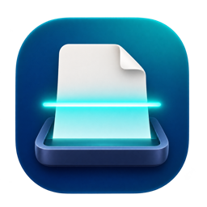

<p align="center">
  
</p>

<h1 align="center">ScanStudio</h1>

<p align="center">
  
  
  
  
</p>

ScanStudio is a native macOS app for scanning and importing documents. Preview the scanner bed, select an area, adjust images, organize pages and save them as searchable PDF, TIFF, PNG or JPEG.

The app uses **ImageCaptureCore**, the framework behind Image Capture and Preview, and works with scanners recognized by macOS, including USB, network/Bonjour, AirScan/eSCL and shared devices. Document processing takes place on the Mac. The interface follows the system language and supports Italian, English, Spanish, French, German and Portuguese.

## Requirements

- macOS 26 or later
- Xcode 26 or later, or the corresponding Command Line Tools (`xcode-select --install`)
- A scanner recognized by Image Capture, for scanning; existing images and PDFs can also be imported

## Build and run

Open `ScanStudio.xcodeproj` in Xcode, select the **ScanStudio** scheme and **My Mac**, then press ⌘R.

Alternatively, build an ad-hoc-signed app bundle from Terminal:

```bash
./build-app.sh
open build/ScanStudio.app
```

For development, `swift build` and `swift run ScanStudio` use Swift Package Manager. The executable launched this way does not have an app bundle. If macOS blocks the ad-hoc-signed app on first launch, use Control-click → **Open**.

## Getting started

1. Turn on the scanner and wait for it to appear. If it remains disconnected, choose **Reconnect**.
2. For a flatbed, choose **Preview** (⇧⌘P), then drag to select an area or use **Detect document**.
3. Choose **Scan** (⌘R). Pages appear in the panel on the right. Alternatively, import existing images or PDFs with ⌘O.
4. Select a page to rotate it, change its color mode or adjust its appearance. The sidebar contains **Scan** and **Adjustments** tabs.
5. Choose a destination, filename and format, then **Save** (⌘S).

## Features

### Scanning and document types

ScanStudio detects available scanners and reconnects when a device becomes available. Supported sources include flatbed, automatic document feeder (ADF), slides and negatives where provided by the scanner. Page size and duplex scanning depend on the device.

The preview allows free selection and automatic document detection. During acquisition, the app displays an activity indicator and progress when the driver reports it. With file-based transfers, the image appears after the scanner sends the page.

The identity-document workflow scans the front and back and combines them on a single A4 page at their original size. Automatic cropping attempts to detect, straighten and orient each side. With duplex ADF, consecutive pages are used for the front and back.

**Multiple items (multi-crop)** scans the entire flatbed once, detects up to 16 rectangular items and corrects their perspective. Check the number and edges of the crops: low contrast, overlapping objects and irregular edges can prevent detection. The full scan remains available if detection fails, or can be added back using **Add full scan**. The latest crops are selected for export, with separate files for single-page PDF/TIFF and image formats.

### Adjustments

Changes are previewed per page or applied to new scans. Available controls include brightness, contrast, exposure, gamma, saturation, sharpness, noise reduction, black-and-white threshold, automatic enhancement and inversion. Double-click a slider label to reset it; **Apply to all** copies adjustments to every page.

Optional processing includes deskew, descreening, software dust reduction, color restoration and gutter-shadow correction. Dust reduction uses a median filter, not an infrared sensor or Digital ICE; descreening uses light blur. These filters can soften details, and gutter correction can lighten nearby text. Review the preview before saving. The original page image remains available while the page is in the project.

### Document recognition and filenames

Vision analyzes a completed scanner preview and shows an initial document-type suggestion. The full preview can include areas outside the selected scan region; acquired pages are analyzed separately.

For filenames, the app extracts text locally and uses a conservative classification. When the type is uncertain and Apple Intelligence is available, Foundation Models may refine it in the background. The result is a suggestion and can be inaccurate. The issuer and date are extracted where possible; otherwise the current date is used. You can choose a document type and edit the filename. A name edited manually is preserved during the current analysis.

Destination presets store a folder and filename template. The default template is `{data} {tipo} {attività}` (date, type, issuer); these placeholder names remain unchanged across languages. Existing filenames receive a numbered suffix instead of being overwritten.

### Export

- **PDF (multipage)** and **PDF (single page)** include a searchable, selectable OCR text layer. Image appearance is unchanged. JPEG compression and quality are configurable.
- **TIFF** supports multipage and single-page output; **PNG** and **JPEG** produce one file per page. Resolution is written to metadata. Black-and-white output uses 1-bit images where supported.
- **Structured Markdown** is optional and disabled by default. When explicitly selected, a separate `.md` file is saved alongside the scan. Vision supplies recognized text and, where detected, headings, lists and tables. When available, the local Apple Intelligence model can suggest headings and list items without rewriting OCR text. Results depend on the source and structure recognition; without the model the output may remain largely plain text. Multipage documents produce one Markdown file with page sections; separate scan files receive separate Markdown files where applicable.
- Export all pages, the selected page or the latest multi-crop results. Existing numbered files are not overwritten.

### Saved settings

Scanner settings, default adjustments, destination presets and export options are restored on the next launch. The format defaults to multipage PDF at each launch. The selected scan area, acquired pages and filename are not persisted.

## Keyboard shortcuts

| Action | Shortcut |
| --- | --- |
| Preview | ⇧⌘P |
| Scan | ⌘R |
| Stop | ⌘. |
| Import images or PDF | ⌘O |
| Save | ⌘S |
| Delete selected page | ⌫ |

## Troubleshooting

- **Scanner disconnected:** turn it on and check that it appears in Image Capture. ScanStudio retries automatically; use **Reconnect** to retry immediately.
- **Cannot open session (−47):** the scanner may allow only one connection. Close other ScanStudio instances and scanning apps, then reconnect.
- **Failed to open a connection (−21345):** restart the app; if the problem persists, power-cycle the scanner.
- **Scan area is inverted:** some devices use a bottom-left origin. Set `scanAreaOriginIsTopLeft = false` in `ScannerManager.swift` if appropriate for your device.
- **Identity document is upside down or tilted:** orientation relies on visible text; rotate the result manually if recognition is inconclusive. Turning off automatic cropping also disables deskew for the card.
- **Icon does not update:** macOS caches app icons; restarting the app and refreshing the Dock/Finder cache can help.

## Technical notes

Image adjustments use Core Image because ImageCaptureCore does not expose hardware controls uniformly across scanners. Scanner transfers use temporary TIFF files. The project uses Swift 5 language mode and is not sandboxed. OCR and optional Foundation Models processing run locally. Vision OCR is currently configured for Italian and English; interface language does not change OCR recognition languages or guarantee document classification in other languages.

The source code is under `Sources/ScanStudio`: `ScannerManager` handles devices, `AppModel` manages state, `DocumentOCR` and `DocumentRecognizer` handle recognition, `ImageProcessor` applies adjustments, `Exporter` writes output, and `Views` contains the SwiftUI interface. Localizations are in `Sources/ScanStudio/Resources`. The older images in `docs/screenshots` show a previous interface.
